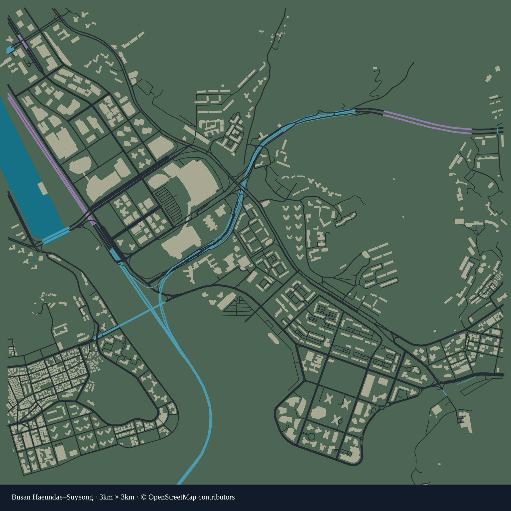

# 부산 해운대·수영강 실제 도로 데이터

게임용 약 **3km × 3km** OpenStreetMap 추출 데이터입니다. 중심점은 위도 **35.165**, 경도 **129.14**이며 센텀시티·수영강 하구·마린시티 및 해운대 서쪽 일대를 포함합니다. 정확한 경계는 [manifest](data/manifest.json)에 있습니다.



## 파일

- `data/raw/haeundae-suyeong.osm.json`: 수집한 원본 OSM 응답.
- `data/query.overpassql`: 재수집에 사용한 쿼리.
- `data/roads.geojson`: 도로 이름, OSM ID, 일방통행, 폭·차선 태그와 원본 중심선.
- `data/derived/unity-map.json`: 미터 단위 Unity 도로 메시, 경로 그래프, 건물 외곽선, 해안·하천 지형과 택시 정차 후보.
- `data/derived/statistics.json`, `validation.json`: 통계와 자동 검증 결과.
- `unity/`: 이 게임 프로젝트에서 데이터를 적용하는 편집기·런타임 소스.

## 재생성

Node.js 20 이상에서 실행합니다.

```sh
npm ci
npm run fetch   # 원본을 새로 수집할 때만 실행
npm run build
npm test
```

## 실제 데이터와 게임용 가정

- 경도·위도와 OSM 노드 ID를 보존하며, Unity X는 동쪽, Z는 북쪽입니다. **1 Unity 단위 = 1m**입니다.
- 차량이 다닐 수 없는 보행로·계단 등과 출입 금지·사유 도로는 주행 도로에서 제외합니다.
- 교차로는 실제 공유 OSM 노드로 연결합니다. 평면에서 겹친 다른 층의 도로를 임의로 교차로로 연결하지 않습니다.
- 일방통행 방향은 보존합니다. 회전 금지 관계 및 시간별·차종별 조건부 통행 제한은 구현하지 않았습니다.
- 폭·차선 태그가 없는 도로 폭은 도로 등급별 **게임용 추정값**입니다.
- 교량·터널 높이는 `layer` 태그로 만든 **추정 높이**이며 측량값이나 DEM 지형이 아닙니다. 진입 경사는 완만하게 제한합니다.
- 건물 외곽선은 OSM 기반입니다. 높이 태그가 없으면 추정하며, 추정 도로 폭과 충돌하는 외곽선은 주행 공간을 확보하도록 잘라냅니다. 실사 건물 모델이나 실제 외관을 제공하지 않습니다.
- 경계에서 잘린 도로·분리된 도로도 시각 데이터에는 남깁니다. 승객 운송과 일반 차량은 왕복 경로가 존재하는 가장 큰 강연결 도로망을 사용합니다.
- 기존 가상 섬도시를 덮어쓰지 않고 `Busan_Haeundae_RealRoads` 플레이 씬에 적용합니다.

## 출처·이용 조건

**© OpenStreetMap contributors — ODbL-1.0**

[OpenStreetMap 출처 및 저작권](https://www.openstreetmap.org/copyright) · [데이터 라이선스](LICENSE-DATA.md)

실제 지도를 충실히 재현한 범위와 게임용 추정값을 구분해서 사용하세요. 운전 내비게이션이나 실제 통행 판단용 자료가 아닙니다.
